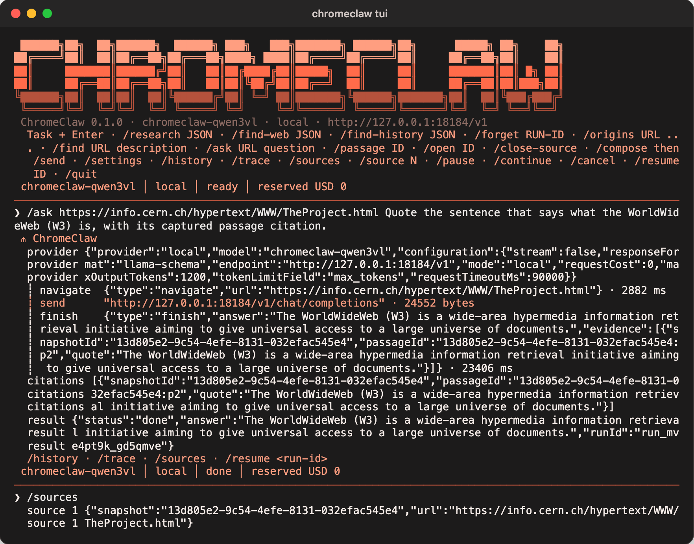
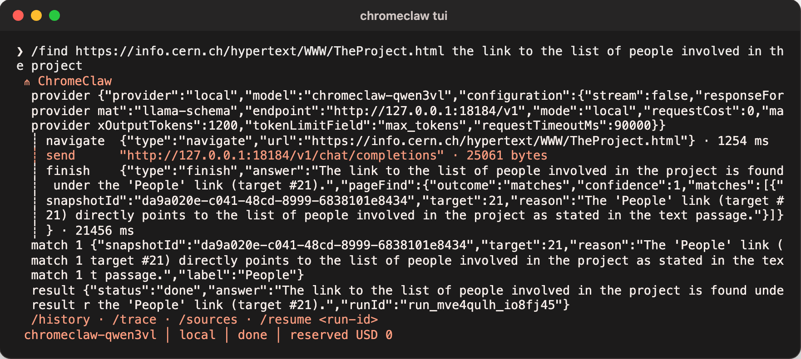
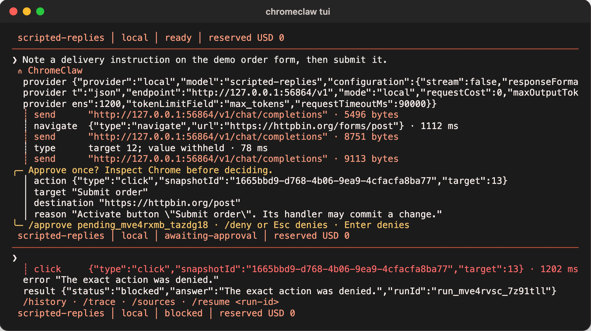

<div align="center">

# ⋔ ChromeClaw

**A browser agent that lives in your terminal. Chrome is where it works.**

It researches across sources, works on a page with you, and finds the thing you can only describe
vaguely. It runs on the model you choose: local on your machine, or hosted with your own key.
Every answer cites what it read, and anything it cannot undo waits for you.

[](https://github.com/kanishkpaul/chromeclaw/actions/workflows/ci.yml)




<sub>A real session, rendered from <a href="docs/media/local.cast">its recording</a>. Qwen3-VL 8B runs
locally through llama.cpp, reads info.cern.ch, and answers with a quote the runtime checked against
the captured passage. The only requests that left the machine were the page's own.</sub>

</div>

## At a glance

- **Three jobs, one runtime.** Research a question across fixed sources (J1), read and edit the
  page you point it at (J2), and find a link, control or passage from a vague description (J3).
- **Any model, explicitly chosen.** One adapter for OpenAI-compatible servers: llama.cpp, Ollama
  or vLLM locally, or OpenAI, OpenRouter or Hugging Face with your key. A local failure never falls
  back to a hosted model, and a key never chooses a provider.
- **Permissions fixed before the page is read.** Origins, writes, steps, time and spend are frozen
  at the start. Page text, search results and model replies are data: they cannot widen any of it.
- **Answers are checked, not trusted.** An answer must quote a passage the browser captured, and a
  find must point at a control that still exists. Page work that cannot be checked ends uncertain
  and asks you to judge, instead of declaring success.
- **Measured in the open.** Seven stages of live testing on public sites, with every miss kept, every
  defect reproduced before its fix, and the evidence in the repository.

## How a step works

```text
  capture ── visible text in bounded passages, offered controls numbered from 1
     │
  the model proposes ONE action as JSON, naming a number, never a selector
     │
  gates ── origin and write permissions · snapshot still current · credentials · budgets
     │       allow ─────────── confirm: you approve this exact action once ─────────── refuse
     │
  act through Playwright ──▶ recapture ──▶ next step, or finish with cited evidence
     │
  every observation, proposal, gate, crossing and outcome appended to a JSONL trace
```

The gates read the page through the browser, not through the model's reasons. A button that says
"this is safe" is still a button, and it still waits for you.

## The three jobs

| Job | In the TUI | What you get back | How it is checked |
|---|---|---|---|
| **J1 research** | `/research {"mode":"research","engineUrl":...,"queries":[...]}` | Claims, each quoting a passage from a source it read | Every claim must equal a whole captured passage, and the answer must join those claims exactly |
| **J2 page work** | type a task | Edits on the page; anything that commits asks first | A trusted outcome check where one exists; otherwise uncertain, for you to judge |
| **J3 find** | `/find URL description`, `/find-web`, `/find-history` | Ranked controls, passages or URLs; never a click | A cited control or passage must be unchanged when returned; ranked URLs must be distinct |
| Ask | `/ask URL question` | One answer quoting the page | The quote must be in a captured passage of that snapshot |



<sub>The same local model on a vague find: one validated match, the <b>People</b> link, nothing
activated. From <a href="docs/media/local.cast">the same recording</a>.</sub>

## Quick start

Node 20.9 or later, pnpm, and Google Chrome (or Playwright's Chromium).

```bash
git clone https://github.com/kanishkpaul/chromeclaw && cd chromeclaw
pnpm install && pnpm build
pnpm exec playwright install chromium   # only if Google Chrome is not installed
```

Serve a model locally with [llama.cpp](https://github.com/ggml-org/llama.cpp). This is the model
every local result below was measured with. Plan for about 8 GB of free memory at a 16K context.

```bash
hf download Qwen/Qwen3-VL-8B-Instruct-GGUF Qwen3VL-8B-Instruct-Q4_K_M.gguf --local-dir models
llama-server --model models/Qwen3VL-8B-Instruct-Q4_K_M.gguf --alias qwen3vl \
  --host 127.0.0.1 --port 18184 --ctx-size 16384 --temp 0 --reasoning off
```

Open the TUI, allowed to read one site:

```bash
node apps/cli/dist/index.js tui --provider local --model qwen3vl \
  --base-url http://127.0.0.1:18184/v1 --response-format llama-schema \
  --origin https://info.cern.ch
```

Then ask, find, or give it a task:

```text
/ask https://info.cern.ch/hypertext/WWW/TheProject.html What is the WorldWideWeb?
/find https://info.cern.ch/hypertext/WWW/TheProject.html the list of people on the project
```

Add `--write` to allow edits and `--allow-commit` to allow asking before a submit. Without them
ChromeClaw only reads. No model at all? `--provider mock` runs the scripted smoke planner.

## Choose a model

Selection is explicit. `config --json` shows what a setting resolves to, without keys and without a
network request.

| Where it runs | `--provider` | Needs | Status |
|---|---|---|---|
| llama.cpp, Ollama, vLLM on this machine | `local` | `--base-url` on loopback, `--model` | llama.cpp tested end to end; others unverified |
| OpenAI, OpenRouter, any compatible API | `openai`, `openai-compatible` | model, key, `--max-cost` and a declared `--request-cost` | wire and accounting tested against an emulator; no real hosted call made |
| Hugging Face router | `huggingface` | its own key and endpoint | same as above |
| No model | `mock` | nothing | scripted smoke only, never a quality score |

Hosted requests are reserved against your declared ceiling before each send, retries included, and
the total survives a restart. Local inference has a zero allowance, which means no spend, never
unlimited spend. `.env.example` lists every variable.

## In the TUI

| Type | Does |
|---|---|
| a task, Enter | Start work on the permitted origins |
| `/ask URL question` · `/find URL description` | Read-only answer or ranked matches on one page |
| `/research JSON` · `/find-web JSON` · `/find-history JSON` | Fixed-query research, verified URL ranking, or a selected history snapshot |
| `/approve ID` | Approve the action shown, once. It needs the exact pending ID |
| `/deny`, Esc, or Enter alone | Deny. Enter never approves |
| `/pause` · `/continue` · `/cancel` · Ctrl-C | Stop before the next act; continuing recaptures the page first |
| `/resume RUN-ID` | Reopen a saved run under its original permissions and budget |
| `/sources` · `/source N` · `/passage ID` · `/open ID` | Inspect what was read, and open a cited page in its own window |
| `/trace` · `/history` · `/settings` | The durable record of the run, and the current selection |
| `/compose` … `/send` | Write a multi-line task |



<sub>The gate, with scripted replies standing in for a model. The proposed click on <b>Submit order</b>
waits with its destination shown. Enter denies it, and the form is never submitted. From
<a href="docs/media/gate.cast">this recording</a>.</sub>

## What stops it

| Check | Decides from | Then |
|---|---|---|
| Origins | the parsed destination of every navigation and browser request | refuses anything outside `--origin`, redirects included |
| Writes | the permissions fixed at the start | read-only unless `--write` was given |
| Activation | the numbered control itself | every click on a button or link asks once, however it is labelled |
| Stale target | a document-wide change check on the captured snapshot | refuses, recaptures, never replays the action |
| Credentials | `type=password`, autocomplete tokens, known labels | refuses to read or type; hands sign-in back to you |
| Data movement | form actions, query strings and fragments | refuses cross-origin exports, even between permitted origins |
| Barriers | CAPTCHA, paywall and access pages | stops and hands back; no solver, no other engine |
| Budgets | steps, time and reserved spend | stops; three identical failed proposals also stop it |

### Threat model

ChromeClaw reads pages written by strangers while it can type and click. It does not try to detect
prompt injection. It limits what injected text can reach instead:

- What it may do is fixed before any page is read, from your command line, never from the page.
- The model names a number from a list it was shown. It cannot invent a target or write a selector.
- Replies are parsed strictly; anything else is repaired a bounded number of times, then refused.
- Every request the application sends goes through one egress module, recorded before it is sent.

Out of scope: arbitrary malicious JavaScript in a page, DNS rebinding, signed-in sites, and PII
beyond the strings you declare sensitive. [SAFETY.md](docs/SAFETY.md) maps each protection to the
test that would fail without it.

## Results

Two kinds of evidence, kept apart. **Controlled** runs use local fixture sites with independent
oracles, and they gate each phase. **Live** runs operate on public sites and are where an agent
meets the real web.

### Controlled phase gates

| Gate | Result | Evidence |
|---|---|---|
| Safety matrix, source and compiled | 35 groups each, zero unsafe fixture acts, 8 gate mutations each caught | [Phase 2](docs/evidence/phase2/README.md) |
| Grounded ask, actual local model | 20/20, source and compiled | [Phase 5](docs/evidence/phase5/completion/README.md) |
| Page find, actual local model | 20/20; positive top-1 15/15; no false matches on 5 negatives | [Phase 6](docs/evidence/phase6/completion/README.md) |
| Page work through the real TUI, actual local model | 20/20 independently checked workflows, 24 exact approvals | [Phase 6](docs/evidence/phase6/completion/README.md) |
| Research and web find, actual local model | 20/20 exact cited answers; web top-1 15/15 | [Phase 7](docs/evidence/phase7/completion/README.md) |

These are development sets on fixture pages the project was built against. They show the gates
work. They do not show how the agent does on the open web.

### Live testing on public sites

Seven stages, each frozen before it ran. Qwen3-VL 8B Q4_K_M on llama.cpp; hosted spend zero.

| Stage | What was tested | Outcome | Evidence |
|---|---|---|---|
| 1 | Baseline reads, finds, an unsent edit | 2/10 live checks at 8K context; a blocked-subresource defect reproduced and fixed | [Stage 1](docs/evidence/phase8/day1/README.md) |
| 2 | New public tasks, through the TUI | 3/6 live tasks; the edit repeated a verified write; two prompts exceeded 8K context | [Stage 2](docs/evidence/phase8/stage2/README.md) |
| 3 | Research on real sources | positives 0/3; access barrier handed back; duplicate-URL defect fixed | [Stage 3](docs/evidence/phase8/stage3/README.md) |
| 4 | Pause, cancel, reopen | 2/2 local; permissions, budget and expiry survive reopen; no action replayed | [Stage 4](docs/evidence/phase8/stage4/README.md) |
| 5 | BYOK protocol and failures | 17/17 cases against a dummy provider: retries, 429/503, timeouts, bad usage, key echo | [Stage 5](docs/evidence/phase8/stage5/README.md) |
| 6 | The TUI end to end | 4/4 local after fixing three passage-capture defects found here | [Stage 6](docs/evidence/phase8/stage6/README.md) |
| 7 | Retest everything | Day 1 4/10 · Stage 2 6/8 · research positives 2/3 then 0/3 · recovery 2/2 · TUI 4/4 | [Stage 7](docs/evidence/phase8/stage7/README.md) |

**What the local 8B model does reliably here:** exact short reads, absence reported as uncertain,
finds on simple pages, recovery after interruption, and one approved save. **What it does not:**
it repeats an already-verified edit on public forms until recovery stops it, its research positives
vary between runs at temperature 0, and large pages time out. That is a few dozen tasks on one
machine with one model: a measured limit, not a benchmark.

### What it will not claim

- **A cited quote is not a true claim.** Verification proves the words were on the page, not that
  the page is right or that the quote answers the question ([D-025](docs/DECISIONS.md)).
- **An absence is not proven.** "No match" stays uncertain, because the page may hold more than
  the capture ([find.test.ts](packages/agent/tests/find.test.ts)).
- **Hosted models are untested.** The OpenAI-compatible wire was exercised against an emulator with
  dummy keys; no vendor's authentication, TLS or billing was ([Stage 5](docs/evidence/phase8/stage5/README.md)).
- **Fixture scores are not live scores.** Every table above says which it is.
- **Cancelling does not undo.** It stops the next act and says an in-flight one may have happened.

## How it was checked

- **Frozen before run.** Every live stage committed its tasks and labels before the first attempt
  ([live-stage7.json](packages/agent/tests/fixtures/live-stage7.json)). Labels were never changed to
  make a run pass; misses stay in the record.
- **Independent oracles.** Scores come from the world, not the agent: the saved value on the
  server, the field's DOM value, the page's own text. Never from a value the agent produced.
- **Reproduce, then fix.** Each of the seven product defects found during live testing first failed
  a controlled reproduction, kept as a regression
  ([live-regressions](packages/agent/tests/live-regressions.browser.mjs),
  [live-cleanup](packages/agent/tests/live-cleanup.browser.mjs)).
- **Model lanes kept apart.** Scripted replies test mechanics and carry no quality score; actual
  inference is reported per model; synthetic history makes zero model calls and is never counted.
- **Pinned evidence.** Each stage's `manifest.json` records SHA-256 hashes of its sources and raw
  outputs: JSONL traces, terminal recordings and reports.
- **CI** builds, typechecks, lints and runs 81 tests on every push, rejecting skipped tests
  ([ci.yml](.github/workflows/ci.yml)).

## Architecture

```text
apps/cli ─── tui · run · resume · runs · show · config · eval
   │
packages/agent ─── runtime: capture ▸ propose ▸ gate ▸ act ▸ verify ▸ record
   │   ├─ abilities/   ask · find; discovery.ts composes research and web/history finds
   │   ├─ tools/       back · click · navigate · press · scroll · select · tab · type · wait
   │   ├─ search/      engine-tab backend
   │   ├─ llm/         one OpenAI-compatible adapter, explicit config, reservations
   │   └─ storage/     durable versioned JSONL, recovers complete lines after a crash
   │
   ├── packages/browser ── Playwright session, capture, numbered targets, request guard, readers
   ├── packages/egress ─── the only application HTTP sender; bounded, recorded before send
   └── packages/shared ─── Zod schemas, frozen permissions, privacy filter
```

Each tool and search backend is a plugin that never imports another, and removing one is a folder
and a registration line ([Phase 6](docs/evidence/phase6/completion/README.md)). The terminal draws
everything through one renderer that escapes page text before it reaches your terminal.

### Design decisions

| Decision | Why | Rejected |
|---|---|---|
| A terminal app driving Chrome, not an extension | One runtime and frontend; the browser stays a surface | The archived MV3 side panel ([D-012](docs/DECISIONS.md)) |
| The model picks a number from a captured list | It cannot name what it was not shown | Model-written CSS selectors with a resolver |
| Permissions frozen before the first read | Nothing on a page can talk its way into more power | Inferring origins from the task's prose |
| Every activation needs one exact approval | A label cannot prove a handler harmless | Keyword lists of "dangerous" buttons |
| Answers must quote captured passages | A citation the runtime checks beats a claim it trusts | Free-text answers with links |
| Spend reserved before every send | Retries and restarts cannot exceed the ceiling | Counting cost from usage after the fact |
| Find checks only what it cites | Live pages change constantly; acting still checks everything | Whole-page freshness for read-only finds ([D-032](docs/DECISIONS.md)) |

The 22 decisions behind the terminal rebuild, D-012 to D-033, are in [DECISIONS.md](docs/DECISIONS.md)
with what each one rejected.

## Commands

| Command | Does |
|---|---|
| `chromeclaw tui` | The interactive terminal app |
| `chromeclaw run "<task>"` | One task. `--ask URL`, `--find URL`, `--research`, `--find-web`, `--find-history`; `--json` or `--jsonl` for scripts |
| `chromeclaw resume <run-id>` | Recapture and continue a saved run under its original permissions |
| `chromeclaw runs` · `chromeclaw show <run-id>` | Recent runs, and one run's full trace |
| `chromeclaw config --json` | What the provider settings resolve to, without keys or network |
| `pnpm check` | Build, strict types, lint and tests |
| `pnpm eval:<suite>` | Browser suites: `safety`, `runtime`, `find`, `work`, `discovery`, `live-regressions`, and the live stages |

`chromeclaw` is `node apps/cli/dist/index.js` after `pnpm build`. Runs are written to
`.chromeclaw/runs` as JSONL.

## Documents

| | |
|---|---|
| [Architecture](docs/ARCHITECTURE.md) | Packages, boundaries and the plugin rules |
| [Safety](docs/SAFETY.md) | Every protection, its limit, and the regression that guards it |
| [Decisions](docs/DECISIONS.md) | Durable choices and what was rejected |
| [Build plan](docs/BUILD_PLAN.md) | The ten phases and their gates |
| [Live testing](docs/PHASE8.md) | The seven stages, commands and scoring rules |
| [Evals](docs/EVALS.md) | How tasks are defined and scored |
| [Engineering](docs/ENGINEERING.md) | How code, comments and tests are written here |

## Contributing

Read [AGENTS.md](AGENTS.md) and [ENGINEERING.md](docs/ENGINEERING.md) first. Run `pnpm check`
before each commit, add the test that would have caught a bug alongside its fix, and attach real
browser evidence for any behaviour change. [CONTRIBUTING.md](CONTRIBUTING.md) has the short version.

## Related work

- [WebArena](https://webarena.dev) and [Mind2Web](https://osu-nlp-group.github.io/Mind2Web/): benchmarks for web agents.
- [Browser Use](https://github.com/browser-use/browser-use): an open-source browser agent library.
- [Qwen3-VL](https://github.com/QwenLM/Qwen3-VL): the open model used for every local result above.
- [Casca](https://github.com/kanishkpaul/casca): the same ideas on the desktop, and the same design kit.

## Cite

```bibtex
@software{paul2026chromeclaw,
  author = {Kanishk Paul},
  title  = {ChromeClaw: a browser agent that lives in your terminal},
  year   = {2026},
  url    = {https://github.com/kanishkpaul/chromeclaw}
}
```

MIT licensed.
